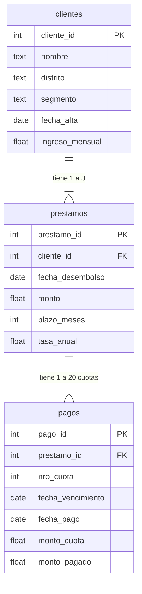

# Esquema del dataset fintech (ficticio)

Referencia rápida para escribir consultas SQL sobre `data/clientes.csv`, `data/prestamos.csv` y `data/pagos.csv`.

## Diagrama de relaciones



## Tablas

| Tabla | Filas | Una fila es… | Llave propia (PK) | Se une con… |
|---|---|---|---|---|
| `clientes` | 60 | un cliente | `cliente_id` | `prestamos` por `cliente_id` |
| `prestamos` | 106 | un préstamo | `prestamo_id` | `clientes` por `cliente_id` · `pagos` por `prestamo_id` |
| `pagos` | 884 | una cuota | `pago_id` | `prestamos` por `prestamo_id` |

## Relaciones y tamaño del JOIN

| JOIN | Relación | Cada fila de la izquierda coincide con… | Filas del resultado |
|---|---|---|---|
| `prestamos` JOIN `clientes` | muchos a uno | exactamente 1 cliente | 106 |
| `clientes` JOIN `prestamos` | uno a muchos | 1 a 3 préstamos (1.8 en promedio) | 106 |
| `prestamos` JOIN `pagos` | uno a muchos | 1 a 20 cuotas (8.3 en promedio) | 884 |
| `prestamos, clientes` (coma, sin ON) | producto cartesiano | todos los clientes | 6 360 ⚠️ |

**Regla:** el resultado de un JOIN tiene tantas filas como el lado de "muchos".
**Truco para deducirlo:** si una tabla tiene más filas que la otra (884 cuotas vs 106 préstamos), cada fila de la más chica coincide en promedio con varias de la grande → uno a muchos.

⚠️ Después de unir con el lado de "muchos", **no sumes columnas del lado de "uno"**: `SUM(p.monto)` tras `prestamos JOIN pagos` repite cada préstamo una vez por cuota.

## Columnas clave

| Columna | Significado | Nota |
|---|---|---|
| `segmento` | Masivo o Premium | 47 clientes Masivo, 13 Premium |
| `monto` | Dinero desembolsado | Total 699 100 |
| `plazo_meses` | 6, 12, 18 o 24 | |
| `tasa_anual` | Tasa de interés (0.20 = 20%) | No se suma |
| `fecha_pago` | Fecha en que se pagó la cuota | **Vacía (NULL) = cuota impaga** (34) |
| `monto_pagado` | Lo pagado en la cuota | NULL si está impaga |

## Ver el esquema desde SQL

```sql
SELECT COUNT(*) FROM clientes;      -- filas
PRAGMA table_info(clientes);        -- columnas
SELECT * FROM clientes LIMIT 3;     -- muestra de datos
```
